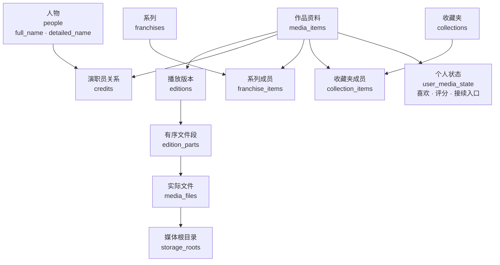

# video-x 数据库详细设计 · v0.5 产品承接版

> 本轮先读[产品与数据库承接设计](product-reconciliation.md)：增加 5 列，修正草稿人工确认及组发布规则，补充 17 项约束验证。完整字段字典、来源、SQL 和模型元数据已同步。

更新于 2026-11-17。当前为 **58 张候选表、568 个字段、127 条外键**，全部新字段已登记业务来源和使用规则。类型与约束在独立临时 PostgreSQL 16.14 验证，79 项检查通过。**应用尚未接入、真实迁移尚未执行；候选集合包含明确后置项，不是首版范围定稿。**

先读[新字段从哪里来、在哪里用](field-guide.md)，再按表查看以下五组字典。每张表先给出结构，再给出同名字段的来源、使用场景、写入者、迁移/初始化和首版建议。业务依据与真实数据验证分别记录，不混为一谈。

## 本轮确定的变化

- 人物保留 `full_name` 与 `detailed_name`，分别承接旧字段；不设 alias 列和 person_aliases 表，不做别名录入/搜索/自动合并别名。
- 保留个人评分：`user_media_state.rating` 为 1～5 星整数，NULL 表示未评分；设置、修改和清空互不影响喜欢、已看或收藏夹。
- 首版取消影片待清理功能，不设置 `marked_for_review` 的新字段、筛选或任务。来源差异复核和技术资源回收不属于该业务。
- 补齐旧封面方向、中文资料标记，以及标签分类、属性组、显示开关。旧标签不会在迁移时自动拆成 genres。
- 旧身份映射增加 `key_name` 和标签目标外键，区分旧主键与业务编码。旧喜欢时间未知可保持 NULL，不伪造历史时间。

本次还确认：单账号通用设计，14 组上下部按有序分集处理，全部旧任务及结果不迁。以上是新平台设计变更，未修改旧系统业务表或客户端行为。

随后确认：旧观看进度与旧毫秒断点全部不迁；新系统初始化无续播记录，从真实定位与播放建立。详细交互、起播确认、上报与跨端规则见[观看进度设计](../playback.md)。2026-11-17 又确认作品/演员单分类、分类筛选、人工发布及常见文件原生播放范围，见[范围确认](confirmed-scope.md)。本轮新增会话起播模式/目标段/目标毫秒及版本完成时间四个字段。

分类隐藏的最后一项产品含义也已明确：保留手动开关用于收起空入口；有影片时含后代计数并提示，确认后仍可隐藏，仅影响导航。现有 is_visible 可承接，不增加字段。

## 先看主干

一条作品资料可关联播放版本，版本通过有序文件段引用实际文件。人物、系列、收藏夹通过关系表关联作品；它们保留现有业务信息，存放位置与工程状态会重新组织。



这是主干关系，完整基数和外键见[分域 ER 图](relationships.md)。14 组旧父子资料已确认是上下部/Part 等有序分集，使用 group→episode，不强制季；每集各有自己的版本和断点。未来 show 可直接带集，也可按真实资料带 season。

## 文档入口

| 入口 | 内容 |
| --- | --- |
| [本次确认与来源说明](confirmed-scope.md) | 单账号、有序分集、人物扩展后置、旧任务全不迁；观看进度/文件大小/喜欢时间的代码依据 |
| [观看进度与继续播放](../playback.md) | 旧进度不迁、真实定位确认、从头播放、跨端接管、完成与已看的区别及播放器验收 |
| [字段阅读指南](field-guide.md) | 已确认决定、来源标签、关键示例、首版建议与后置边界 |
| [作品与资料字典](tables-catalog.md) | 16 表：作品、双名称人物、演职员、系列、分类、分组标签、片商、图片，以及后置 genre 候选 |
| [媒体库与文件字典](tables-library.md) | 7 表：逻辑库、媒体根、实际文件、轨道、版本、文件段与后置外挂字幕 |
| [个人整理与播放字典](tables-personal.md) | 11 表：收藏、评分、喜欢、播放；身份按通用单账号结构使用 |
| [来源与维护字典](tables-metadata.md) | 14 表：来源身份、快照、字段维护与差异；含后置网站评分、词汇映射 |
| [导入与任务字典](tables-operations.md) | 10 表：服务端导入、持久任务、可靠写入、迁移映射 |
| [旧字段去向](legacy-field-mapping.md) | 103 个旧持久字段全部有处置：47 项已有对应，38 项需语义/转换验证，2 项主动取消，14 项旧任务及 2 项旧进度字段明确不迁 |
| [历史依据复核](evidence-review.md) | 旧代码和 2026-09-29 备份的证据、v0.1 的问题与本次修订关系 |
| [分域关系图](relationships.md) / [外键清单](foreign-keys.md) | 主要关系和全部 125 条实际外键 |
| [建表草案](schema.sql) / [约束检查](verify.sql) | 独立 schema 的候选定义；79 项正反例，样例最终回滚 |
| [机器可读字段依据](field-provenance.json) | 568 条来源、用途、使用场景、写入、初始化及首版建议 |

## 来源与首版建议是两个维度

- 来源：沿用、转换沿用、拆分重组、方案新增、技术新增、探测新增、待定扩展。新 UUID、版本、时间和关联列不等于新增了同等数量的产品功能。
- 首版建议：建议保留、待裁剪、后置。候选 SQL 保留后置定义以供评审，正式 migration 必须按已确定的闭环重新收敛。
- 账号/默认 profile/设备/会话采用通用单账号职责；无多账号公网流程。独立 genre、网站评分、NFO、生日/角色名等明确后置；季仅按未来真实资料使用。
- 写入者与使用场景表示计划行为，没有宣称相应接口、页面或 worker 已经实现。

## 关键业务规则

1. **资料、文件、个人状态分开。** 标题/演员/系列属于资料，路径/大小/轨道属于文件，喜欢/评分/断点属于个人状态。修改资料不清空个人状态。
2. **人物以 ID 关联，两个名称独立。** 姓名不唯一；搜索匹配 full_name、detailed_name 与已确认的来源编号；合并由人工选择保留值，不追加别名。
3. **评分与收藏各自独立。** 评分归作品，同一作品多个版本共享个人评分；加入收藏夹不自动喜欢或评分。网站评分表为后置候选。
4. **标签保留原有组织维度。** 主分类与属性组下保留独立标签身份；隐藏保留已有作品关联，归档与隐藏分开。
5. **来源先产生候选与快照。** 用户接受后再写正式资料；多来源身份不混用电影编号或旧内部编码。人工字段锁定与来源差异是新增方案，粒度仍可裁剪。
6. **文件变化使旧事实过期。** 内容代数、成功探测代数和版本绑定代数配合，避免旧 worker 覆盖新文件结果；播放关系必须确认仍适合当前文件。
7. **断点按版本和文件段保存。** 起播目标固定到文件段和毫秒，实际定位并起播后才写入；代数与序号保护跨端接续。旧百分比和旧毫秒位置明确不迁，累计次数只作旧汇总，不补造历史播放事件。
8. **约束与事务分工。** 外键/唯一/CHECK 不会自动完成人物合并、分类防环、成员集合防覆盖、来源接受与一次性发布；这些仍须在应用事务中实现和验证。

## 可重复生成与验证

结构定义在 `model-spec.json`，逐字段依据由 `tools/build_field_provenance.py` 生成；SQL 注释、字段字典和交互查询共用同一份依据。生成器不连接数据库：

```sh
python3 tools/build_field_provenance.py
python3 tools/generate_schema.py
```

只有明确的临时 PostgreSQL 实例可执行 `tools/verify_design.py`。它要求新测试库名称以 `vx_review_` 开头，创建空库后执行 schema 与检查，再导出 `schema-metadata.json`。工具不会启动服务或删除数据库；数据库连接目标仍需由执行者确认。

```sh
python3 tools/verify_design.py --socket /path/to/test/socket --port 55439 --user test_user --database vx_review_new
python3 tools/generate_dictionary.py
python3 tools/generate_legacy_mapping.py
```

本次实测：PostgreSQL 16.14，58 表、568 字段、127 外键、79 项检查通过。既有检查覆盖双名称、评分、喜欢时间未知、标签与有序分集；本轮新增会话起播目标归属、模式和非负位置检查。未连接现有业务数据库，尚未实测真实播放器定位。

旧任务及其结果 JSON 已明确排除，无需迁移检查。尚未完成：当前运行库只读快照、真实文件重新探测、全量迁移、应用事务与并发验证、真实播放器接续及端到端验收。候选字段的说明完成，不代表这些验证已经完成。
