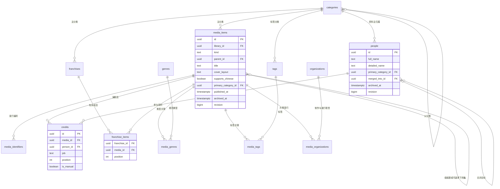
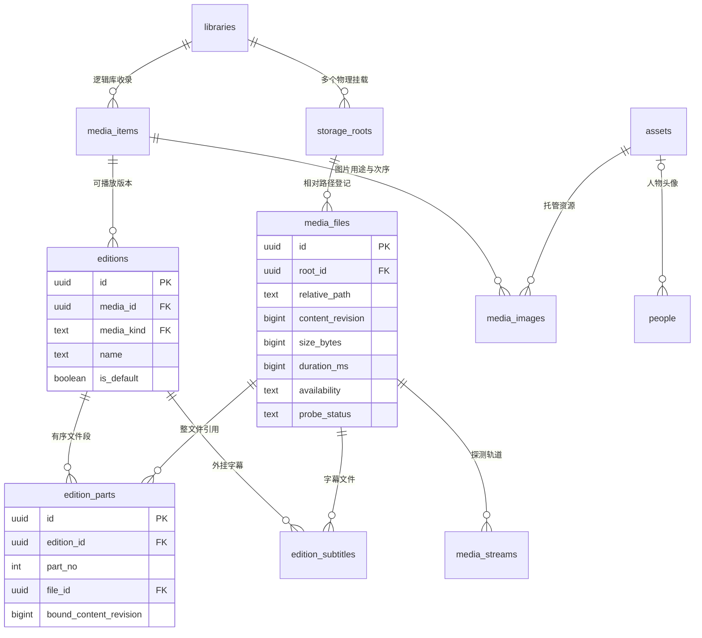
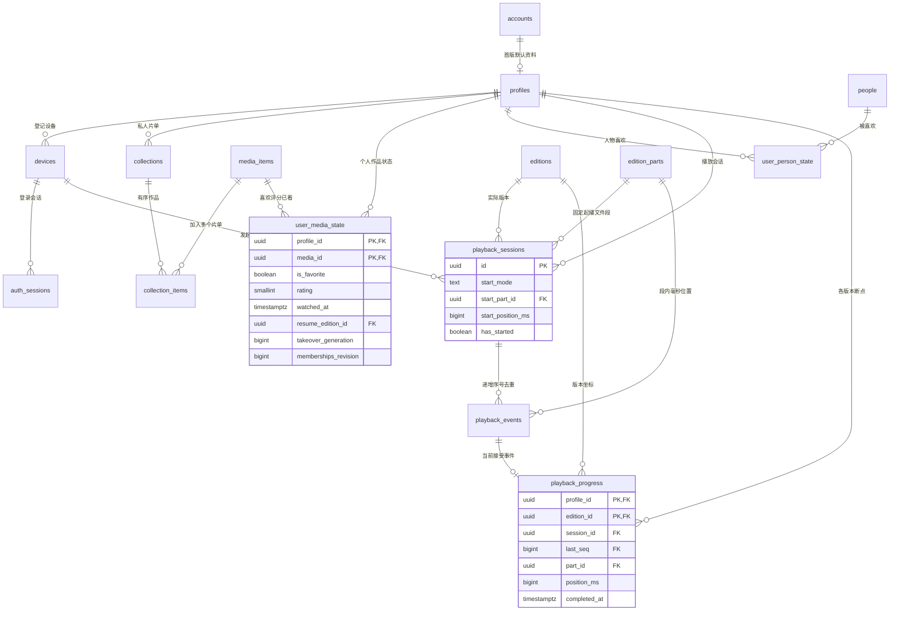
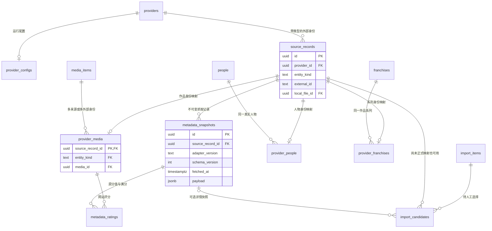
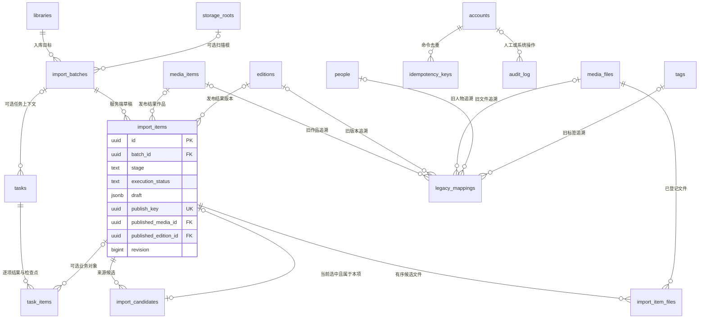

# video-x 分域表关系图 · v0.4

[设计入口](README.md) · [实际外键清单](foreign-keys.md) · [建表 SQL](schema.sql)

这是 v0.4 候选结构图，已同步单账号、通用分集、取消别名、双名称、标签分类归属与旧标签映射。组可直接含集、剧可直接含集或按真实资料带季；旧任务及结果不迁移。独立 genre、网站评分、外挂字幕等后置候选也在图中，不代表首版必须实现；逐字段来源和首版建议见[阅读指南](field-guide.md)。

图中显示主干字段与关系，完整字段、默认值、可空性和约束在各组字段字典。`||` 表示恰好一条，`o|` 表示零或一条，`o{` 表示零到多条；外键存在不等于引用的资料当前未归档。为保持可读性，图中没有重复画出每个编辑者、图片资源和所有复合判别列。

## 1 作品、人物、系列与分类

[作品与资料字段字典](tables-catalog.md)

演员作品列表按 `credits.job=actor` 查询并去重作品；导演也走 credits。人物检索匹配 full_name 和 detailed_name；没有别名表。tags 同时保留 primary_category_id、attribute_group 和 is_visible。类型、标签、发行编号与片商均不挤进作品 JSON。catalog_revisions 是独立的一行树版本，用来串行化分类结构事务，不逐行关联到所有分类。

## 2 作品、版本、文件、轨道与图片

[媒体库与文件字段字典](tables-library.md) · [图片字段](tables-catalog.md#assets)

`edition_parts.file_id` 不全局唯一，支持明确复用文件；同版本不得重复引用同文件。不同版本的段内毫秒位置不能直接互换。没有已知完整段时长时，不计算看似精确的总百分比。

## 3 账号、人物喜欢、收藏夹与播放断点

[账号、个人与播放字段字典](tables-personal.md)

一部作品有一个“最近接续版本”入口，各版本保留各自坐标。会话固定起播目标，实际定位并播放后才更新断点；completed_at 区分版本播放完成与手动已看。新设备接管增加作品级 generation；旧设备离线事件迟到不会覆盖当前断点。旧进度不迁，初始化无续播；详见[观看进度设计](../playback.md)。喜欢影片、喜欢演员和加入片单是三条独立关系。

## 4 来源身份、候选快照与正式映射

[来源字段字典](tables-metadata.md)

同一 provider 的 media/person/franchise 分别有身份空间。适配器版本属于解析过程，不属于作品主键；换解析器或刷新数据不会创建新作品身份。来源配置只存 credential_ref，不在普通 JSON 配置中保存 Cookie。

## 5 人工锁定、差异与关联来源依据

```mermaid
erDiagram
  media_items ||--o{ media_field_state : 白名单字段与集合锁
  people ||--o{ person_field_state : 人工覆盖与来源
  franchises ||--o{ franchise_field_state : 字段与成员锁
  metadata_snapshots o|--o{ media_field_state : 最近接受来源
  metadata_snapshots o|--o{ person_field_state : 最近接受来源
  metadata_snapshots o|--o{ franchise_field_state : 最近接受来源
  metadata_snapshots ||--o{ metadata_change_sets : 待接受差异
  media_items o|--o{ metadata_change_sets : 三选一作品
  people o|--o{ metadata_change_sets : 三选一人物
  franchises o|--o{ metadata_change_sets : 三选一系列
  source_records ||--o{ relationship_sources : 来源声明
  metadata_snapshots ||--o{ relationship_sources : 声明依据
  credits o|--o{ relationship_sources : 六选一演职员
  media_genres o|--o{ relationship_sources : 六选一类型
  media_tags o|--o{ relationship_sources : 六选一标签
  franchise_items o|--o{ relationship_sources : 六选一系列成员
  media_organizations o|--o{ relationship_sources : 六选一片商
  media_images o|--o{ relationship_sources : 六选一图片
```

`metadata_change_sets` 的三个目标外键恰好一个非空。`relationship_sources` 的六个目标外键也恰好一个非空，均由 CHECK + 真实 FK 保证；图中的多条可选线不是允许同时选择所有目标。来源词汇归一 source_value_mappings 单独指向 genre 或 tag，二者恰好选一个。

## 6 导入、任务、可靠提交与旧库映射

[导入与运行字段字典](tables-operations.md)

task_items 的业务目标还可以是文件、作品、人物或根目录，至多选一个；备份等无实体目标的任务允许为空。legacy_mappings 的七类目标恰好一个非空，全量定义见字段字典。

outbox_events 的聚合定位与 audit_log 的历史定位是故意保留的事件/审计标识，不建立“外键到任意表”。它们不承载正式业务关系；outbox 与业务变更在同一事务提交。pg-boss 的队列内部表不属于本模型，不与业务表建立跨 schema 外键。
